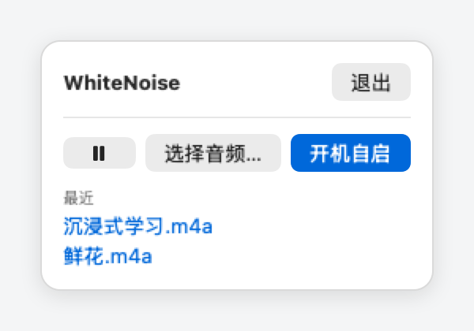
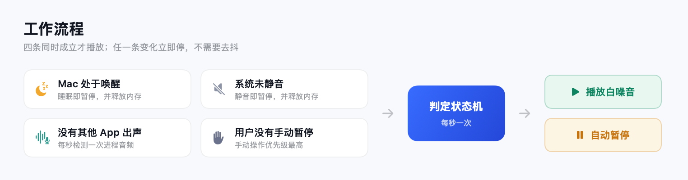

<p align="center">

  

</p>

<h1 align="center">WhiteNoise</h1>

<p align="center">

  <b>让背景音学会「让路」——别人出声，它就自动安静。</b><br>

  macOS 菜单栏白噪音播放器 · 循环播放本地音频 · 检测到其他声音自动暂停 / 恢复 · 纯本地零上传

</p>

<p align="center">

  

  

  

  

</p>

---

## 这是什么

**WhiteNoise** 是一个常驻 macOS 菜单栏的轻量白噪音工具。它能**循环播放你指定的本地音频**（白噪音、雨声、学习氛围音等），并在你开始看视频、听歌或开会——也就是**有其他 App 出声时，自动把背景音暂停**；等对方安静下来，再**自动恢复**。

整个过程无需手动切换，也不会打断正在播放的媒体，适合专注工作、阅读、学习或需要稳定环境音的场景。

<p align="center">

  

</p>

## ✨ 主要特性

- 自动避让：检测到其他 App 正在输出音频（视频 / 音乐 / 通话）时自动暂停，结束后自动恢复。常开，没有开关——这是它的全部功能，不需要你调。
- 手动永远优先：你自己点了暂停，任何自动逻辑都不会把声音抢回来；别人还在响时你点播放，它会硬播到对方安静为止。
- 启动不出声：开机自启、重新打开都只把上次的文件装好并停在暂停态，必须手动点播放才出声。
- 循环播放：环形调度，读到文件末尾直接回绕到开头继续读，不做重新加载；记住最近两个文件，点一下即切。
- 开机自启：一个按钮，蓝底＝已开启，灰底＝未开启。
- 按钮不做假尺寸：每个按钮只有文字那么宽，面板宽度跟着内容收缩（约 248 pt），不写死宽度、切换状态不会漂移。
- 只准开一个：重复启动时旧的会让位给新的，不会出现两只喇叭一起响。
- 省内存：用 AVAudioEngine + AVAudioFile 流式播放，边读边播，内存恒定在几百 KB（不再把整首音频读进内存——394 MB 的文件以前要占掉数百 MB 常驻）。
- 纯本地 · 零上传：不录音、不开麦克风、不接管系统声音，音频数据不离开你的电脑。

## 🎧 支持哪些音频文件

只收 **macOS 自己就能解码**的格式（`AVAudioFile` 直接读，不经任何第三方库）：

| 格式 | 支持 | 说明 |
| --- | --- | --- |
| `.m4a`（AAC） | ✅ | **日常首选**：体积小、硬件解码、CPU 几乎不占 |
| `.m4a`（ALAC 无损） | ✅ | 无损，体积大，循环点最干净 |
| `.mp3` | ✅ | 老格式，能用；首尾自带编码器填充静音 |
| `.wav` / `.aiff` / `.caf` | ✅ | 无损未压缩，体积最大，循环点最准 |
| `.flac` | ✅ | 无损压缩，体积适中 |
| `.aac` | ✅ | 裸 AAC 流，可用 |
| `.ogg` / `.opus` / `.wma` | ❌ | macOS 没有这些解码器，选择器里不会出现 |

采样率、声道数、位深都不用管：引擎会按文件的实际格式自动转换到系统输出。

### 最推荐 m4a 吗

**是，日常用 m4a（AAC）**。白噪音是"听感"内容不是"分析"内容，128–192 kbps 的 AAC 完全够用，同一段音频从 WAV（几百 MB）换成 m4a 通常只剩几 MB，解码还走硬件。

但有一个老实说清楚的取舍：**AAC 和 MP3 的编码器会在文件首尾写入几十毫秒的填充静音**。你循环它的时候，那点空白是**文件本身带的**，不是播放器的锅——想要回绕点绝对干净，用 ALAC（`.m4a` 里的无损）或 WAV / CAF / AIFF。本项目接受块边界几毫秒的衔接空隙，所以 m4a 就够。

## 🎬 工作流程

<p align="center">

  

</p>

每 1 秒评估一次，只有下面**全部条件成立**才播放（`PlayerController.tick()` 里的唯一判定式）：

```swift
shouldPlay = !userPaused && awake && onConsole && !muted && !otherAudio
```

对应到你能感知的「自动暂停」场景：

| 触发条件 | 判定依据 | 恢复方式 |
| --- | --- | --- |
| 其他 App 正在输出音频 | Core Audio 进程音频枚举 + kAudioProcessPropertyIsRunningOutput | 对方停止出声后下一次轮询自动恢复 |
| Mac 进入睡眠 | NSWorkspace.willSleepNotification | 唤醒后自动恢复 |
| 系统输出被静音 | 默认输出设备主通道 / 左 / 右任一 Mute = 1 | 解除静音后自动恢复 |
| 用户手动暂停 | userPaused = true，优先级最高 | 只能手动点播放 |
| 播放被系统打断 | 用 AVAudioPlayerNode.isPlaying 核对，发现"以为在放其实没放"就纠正；拔耳机 / 切设备触发 AVAudioEngineConfigurationChange 时自动重启引擎 | 条件满足时自动重启 |

> 手动操作永远优先。启动（含开机自启）一律「装好文件 + 暂停」，出声只由人点。
> 出错时：文件问题 → 播放键**图标本身**变成红色 ⚠️；自启注册失败 → 「开机自启」按钮里**只剩**一个红色 ⚠️（文字让位给三角）。两处都是同一个三角感叹号，按钮宽度不变、面板不会因为报错变宽，鼠标悬停看具体原因。

## 🚀 快速开始

### 环境要求

- macOS 14.2 或更高（依赖 Core Audio 的进程音频枚举 API）
- Xcode Command Line Tools（提供 swiftc）

```
  xcode-select --install
```

### 编译与运行

```bash
git clone https://github.com/frog-716/WhiteNoise.git
cd WhiteNoise
./build.sh                   # 编译 + 本地签名，生成 build/WhiteNoise.app
open build/WhiteNoise.app   # 启动
```

无需 Xcode 工程、无需开发者账号。`build.sh` 用 `swiftc` 把 `Sources/` 下的文件一次性编译，并 ad-hoc 签名打包成 `.app`。

### 使用

1. 启动后，菜单栏出现扬声器图标，此时是暂停态，不会出声；
2. 点「选择音频…」→ 选中本地音频，立即开始循环播放；
3. 打开视频 / 音乐 / 通话时自动暂停，对方结束后自动恢复；
4. 左侧只有图标的按钮就是播放/暂停（▶ / ⏸），悬停可看当前状态；
5. 「开机自启」：点一下变蓝即为开启，再点变灰即为关闭；注册失败时按钮上只剩红色 ⚠️（不显示文字、宽度不变），悬停看原因；
6. 「最近」列出最近用过的两个文件，点一下即切。

> bundle id 曾先后用过 `com.example.whitenoise`、`com.github.frog716.whitenoise`，现统一为 `com.frog716.whitenoise.app`。换 id 是因为旧 id 在系统状态栏缓存里留下了坏状态，导致菜单栏图标不显示；旧 id 的登录项已一并清理。因此第一次用新版本时「最近」是空的、需要重新选一次音频，属正常现象。

## 📁 项目结构

```text
WhiteNoise/
├── Sources/
│   ├── WhiteNoiseApp.swift    入口：NSStatusItem 菜单栏图标 + NSPopover 面板 + 单实例互斥 + 清理旧登录项
│   ├── PlayerController.swift 播放状态机 / 1 秒轮询 / 文件选择 / 最近记录 / 自启
│   ├── StreamingPlayer.swift  流式播放：分块读 + 环形回绕 + 设备切换自动重启
│   ├── AudioMonitor.swift     Core Audio：谁在出声、系统是否静音
│   ├── AudioFormats.swift     支持的格式清单（选择器、校验、报错文案的唯一出处）
│   ├── ContentView.swift      弹窗界面
│   └── Log.swift              日志（串行写、512 KB 自动重建）
├── Resources/                 图标源文件（1024 底图 + 原始设计稿）与 AppIcon.icns
├── docs/images/               README 配图（banner / 界面 / 流程）
├── Info.plist / build.sh      bundle 配置与一键编译脚本
├── MAP.md                     给开发者/AI 看的项目地图
└── 音频/                      本地音频目录（.gitignore 已忽略，不上传）
```

> `音频/` 目录不会被提交，仓库中不包含任何用户音频。请自备音频文件放入该目录，或用「选择音频…」从任意位置选择。

## 🔒 隐私与安全

- 音频文件仅在本机播放，不上传、不联网（代码里没有任何网络调用）；
- 不访问麦克风、不录音、不截取系统音频内容；
- 仅通过公开的 Core Audio 接口读取「哪些进程正在输出音频」这一状态；
- 「最近」存的是 macOS bookmark 数据，不是明文路径字符串；
- 无账号、无 API Key、无第三方 SDK；
- 日志只记状态跃迁和文件名，位置 ~/Library/Logs/WhiteNoise.log，超过 512 KB 自动重建；
- 开源可审计，欢迎查看源码。

## ⚠️ 已知限制

- 静音的通话、暂停但仍占用音频通道的视频，系统会持续报告「正在输出音频」，可能导致背景音暂不恢复——此时可手动点「播放」（会强行播到对方安静）兜底。
- 极少数不走标准音频通道的应用可能检测不到。
- 不能压低其他 App 的音量（只控制自身播放 / 暂停）。
- 流式循环靠「管线里排 3 块」衔接，回绕点可能有几毫秒空隙（白噪音场景听不出来，已在需求确认时接受）。
- 轮询是 1 秒一次：因为 Core Audio 没有可靠的「某进程开始出声」属性监听，改成事件驱动会漏事件，宁可贵一点电。

## 📄 License

本项目采用 [MIT License](LICENSE)。

---

<p align="center"><sub>Made for focused work · macOS menu bar · WhiteNoise</sub></p>
